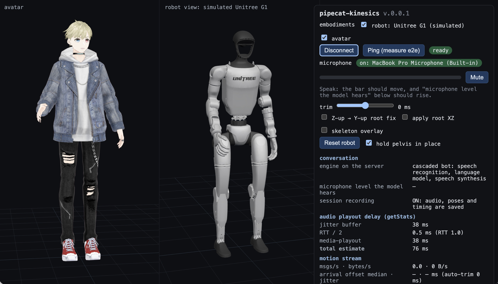

# pipecat-kinesics

Turn-taking body movements for [Pipecat](https://github.com/pipecat-ai/pipecat) voice bots: the bot
tells its clients where it is in its speaking turn, and each client moves its own body to match,
with the timing and size that people show in recorded conversations.



*The browser client during a conversation, while the bot is speaking. The avatar and the simulated Unitree G1 show the same turn cue, each through its own mapping.*

Kinesics is the study of body movement as communication. This project covers the movements around
a speaking turn: opening the mouth before the first word, looking away at the start of a turn,
glancing back at the listener while speaking, returning the gaze at the end, and raising and
lowering a hand.

**Status: prototype.** It runs end to end with a Pipecat bot, WebRTC and a browser, and its timing
is measured (see "Measured timing"). Interfaces are not stable.

## Contents

| Part | Where | What it does |
|---|---|---|
| The bot | `server/bot_cascade.py` | A cascaded Pipecat bot (speech recognition by Deepgram, language model by OpenAI, speech synthesis by Cartesia) that sends turn cues |
| Turn cues, bot side | `server/turncue/` | Pipecat processors that work out the state of the bot's turn (about to speak, first sound, pauses, last sound) and send it as a `bot-turn-cue` message. The message is an RTVI server message (RTVI is Pipecat's protocol for messages between bot and client), carried on the existing WebRTC data channel |
| Shared contract | `server/kinesics_core/` | The contract between a speech stage and the stages that read it (the speech-step frame and its context), and the measure of how much audio is waiting to be sent. `turncue` and `kinesics_core` install together as one package (`pip install -e server`) |
| Turn cues, client side | `web/src/turn-cues.js` | Receives the messages and converts the bot's times to the moment the client hears the sound |
| The kinesics realizer | `web/src/kinesics/kinesics-realizer.js` | Turns the turn state into movements of body-neutral channels (mouth, eyes, head, head pitch, hand, torso lean, blink), on smooth curves, timed against the sound |
| Profiles | `web/src/kinesics/profiles.json` | The movement parameters: angles in degrees, times in milliseconds, speeds in degrees per second. Two settings: `video_call` (measured on the CANDOR Corpus) and `same_room` (measured on Seamless Interaction) |
| Mappings | `web/src/kinesics/mappings.json` | Client-side tables that say which joint or bone shows which channel, with a gain. The bot does not receive them. How a body shows a cue is changed in this file, not in code |
| Two bodies | `web/src/kinesics/vrm-adapter.js`, `g1-adapter.js` | A VRM avatar (mouth, head, neck, eyes, blink, arms, fingers) and a simulated Unitree G1 humanoid robot. The G1 has no neck or eyes, so its mapping shows the look away with the waist |
| Timing report | `server/tools/kinesics_report.py` | For a recorded session, compares when each movement happened with when the sound was heard on the page |

## Documentation

| Document | What it covers |
|---|---|
| [docs/turn-cue-protocol.md](docs/turn-cue-protocol.md) | The `bot-turn-cue` message, version 1: transport over RTVI, the states of a turn, every field, how a client turns a message into the moment to act, measured accuracy, and how to add it to a Pipecat bot |
| [docs/pipecat-modules.md](docs/pipecat-modules.md) | Reference for the bot-side code: each processor, frame and observer, what it reads and pushes, its constructor arguments, requirements and limits |
| [docs/turn-cue-pipeline.md](docs/turn-cue-pipeline.md) | Figures of the bot's whole pipeline and of the frames that pass between its processors |
| [docs/client.md](docs/client.md) | Reference for the client: the turn-cue tracker, the kinesics realizer and its output, the mapping tables, the two body adapters, how to add a body, the page's options and tests |
| [docs/kinesics-profiles.md](docs/kinesics-profiles.md) | Every value in the movement profiles and mappings, marked as measured, derived or chosen |
| [docs/kinesics-movement-measurements.md](docs/kinesics-movement-measurements.md) | The measurements of head, eye, hand and torso movement around turn exchanges in CANDOR and Seamless Interaction |

## Architecture

```
bot (Pipecat)  --bot-turn-cue (RTVI server message, WebRTC)-->  client
                                                                 |  turn-cue tracker: bot time -> heard time
                                                                 |  kinesics realizer + profile -> channels
                                                                 |  mapping table -> joints or bones
                                                                 v
                                                        avatar (VRM)   robot (G1, 29 joint targets)
```

The bot sends only the state of its turn. Everything specific to a body stays on the client.

## Running

Requirements: Python 3.12, Node.js, and API keys for Deepgram, OpenAI and Cartesia. These services
are billed while a client is connected.

Bot:

```bash
cd server
python3.12 -m venv .venv && .venv/bin/pip install -e ".[dev]"
cp .env.example .env        # add the API keys
.venv/bin/python bot_cascade.py
```

Page, in a second terminal:

```bash
cd web
npm install
./scripts/fetch_g1.sh       # downloads the Unitree G1 model (about 34 MB), required for the robot view
npm run dev
```

Open http://localhost:5173/?body=robot,avatar in Chrome, press Connect and allow the microphone.
Headphones prevent the bot from hearing its own voice.

Page options, added to the address:

| Option | Meaning |
|---|---|
| `body=avatar`, `body=robot`, `body=robot,avatar` | Which bodies to show |
| `g1map=forward` (default) or `g1map=side` | The G1 shows the look away as a forward bend, or as a waist turn to the side |
| `setting=video_call` (default) or `setting=same_room` | Which profile to use |
| `vrm=<name>` | Load `web/public/<name>.vrm` as the avatar |
| `frame=face` | Head-and-shoulders camera on the avatar |

Tests:

```bash
cd web && npm test
```

```bash
cd server && .venv/bin/python -m pytest
```

## Measured timing

One live session, 2026-11-18: bot and browser on one machine, Chrome with a microphone, the
`video_call` profile. 20 bot turns, of which 12 ended normally, 2 were interrupted and 6 were
dropped before any sound. Each value compares a movement's key moment with the sound as heard by
the client.

| Movement | Target (from human conversations) | Measured, median | Range | Turns |
|---|---|---|---|---|
| Mouth half open | 430 ms before the first sound | 450 ms before | 302 to 654 ms before | 14 |
| Mouth a quarter open | 830 ms before the first sound | 1,154 ms before | 878 to 6,135 ms before | 14 |
| Look away complete | 300 ms after the first sound | 66 ms early | 224 ms early to 27 ms late | 14 |
| Hand up | 700 ms after the first sound | 36 ms early | 145 ms early to 8 ms late | 13 |
| Eyes back at the end of a turn | 100 ms before the last sound | 38 ms late | 1 ms early to 795 ms late | 12 |
| Mouth closed | 250 ms after the last sound | 29 ms late | 1 ms early to 795 ms late | 12 |

**The mouth has the longest lead of all cues.** Before a long utterance, speakers have the mouth a
quarter open 0.7 to 0.8 s and half open 0.4 s before the first word. The reply's first text reaches
the client about 0.6 s before the sound, which is too late: timed on it, the mouth reached half
open a median 239 ms before the sound (a separate session of 9 turns). The bot's earlier
`preparing` state arrives a median 1.4 s ahead. The mouth alone starts on that state, opens a
quarter, and holds until the time of the first sound is known. In 6 of the 20 turns the reply was
then dropped and the mouth closed again.

## Limitations

- **Movements at the start of a turn are timed on an estimate.** The bot first sends an estimate of
  its first sound; the realizer does not yet re-time a movement when the exact time arrives. The
  look away therefore runs a median of about 70 ms early, and the mouth's half opening varies by
  about 350 ms from turn to turn.
- **The mouth's quarter opening has no time limit.** It starts when the bot begins preparing a reply,
  before any time for the sound is known. When the bot was slow to start speaking, the mouth was
  held slightly open for 6 s in one turn.
- **The realizer is implemented in JavaScript only.** A Python robot client requires a port.
- **The G1 is simulated without balance control.** MuJoCo simulates its motors and limbs with the
  pelvis held in place. The code has not run on a physical robot.
- **Finger, wrist, blink and some mouth values are chosen, not measured.** `docs/kinesics-profiles.md` marks
  every value as measured, derived or chosen.
- **Lip movement** during speech is a placeholder, opened by the loudness of the bot's audio. Only the mouth's resting posture (before the sound, in pauses, at the end) is a turn cue.
- **The page includes a pose-stream player** (`wire.js`, `motion-ring.js`, `retarget.js`) that the
  cascaded bot does not use.

## Licences

Code: BSD 2-Clause (`LICENSE`).

The movement profiles, the two measurement documents, the avatar model and one test fixture: CC
BY-NC 4.0 (non-commercial). `LICENSE-DATA.md` lists each file, its licence, and the notices
required by the data sources.

This work uses the CANDOR Corpus from BetterUp Labs, BetterUp, Inc.
(https://huggingface.co/datasets/betterup/candor-processed) and the Seamless Interaction dataset
from Meta. Only aggregate statistics are published. Neither dataset is included.

Reece, A., et al. (2023). The CANDOR corpus: Insights from a large multimodal dataset of
naturalistic conversation. *Science Advances*, 9(13), eadf3197.
