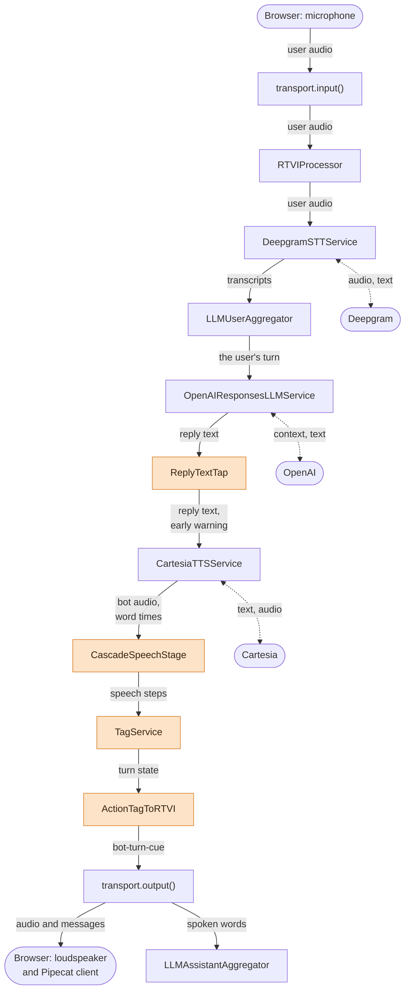
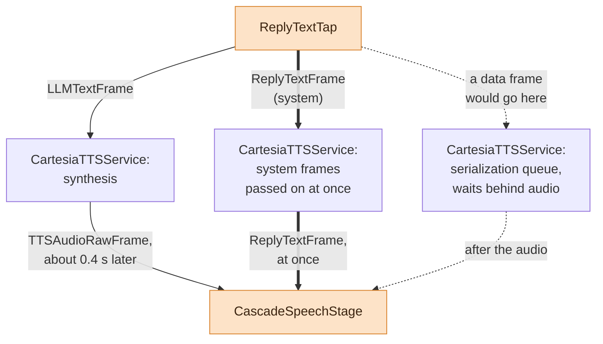
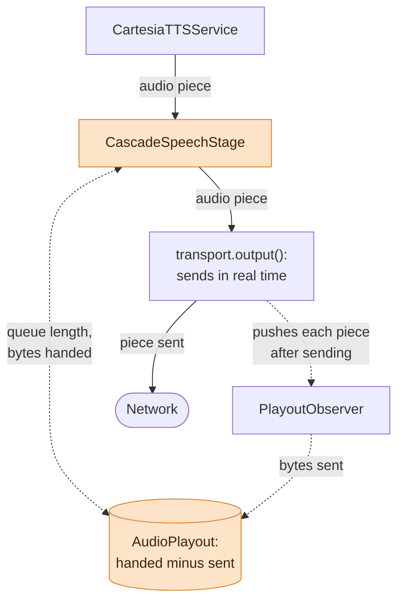
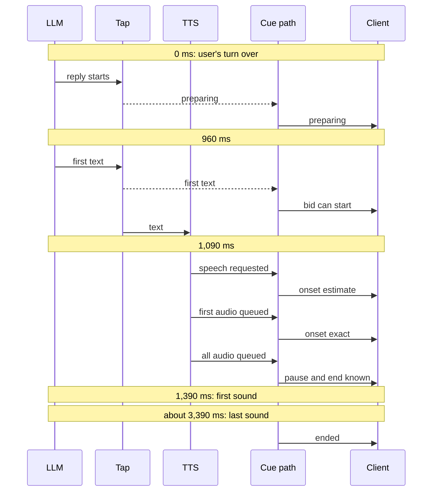
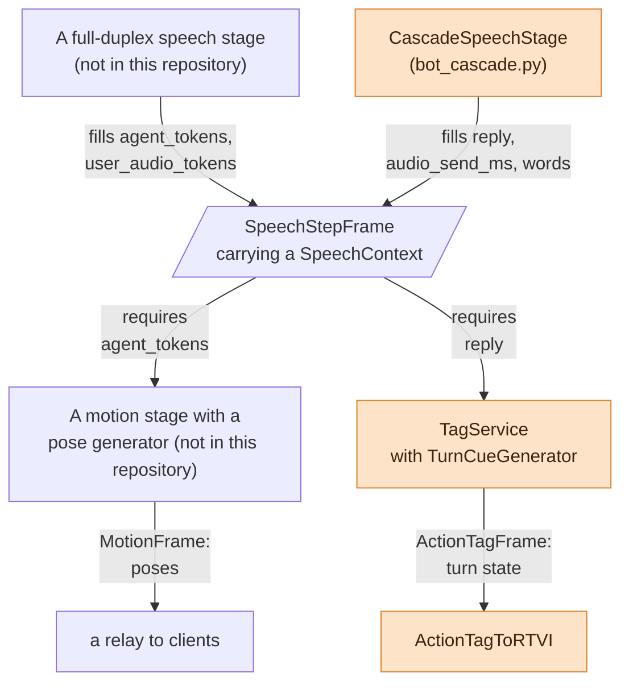

# The cascaded bot's pipeline, with the turn-cue path

*The pipeline of `server/bot_cascade.py` as it runs: its services and processors, and the frames that pass between them. The message the turn-cue path sends to clients is specified in `turn-cue-protocol.md`; a reference for each module is in `pipecat-modules.md`. Frame behaviour was checked against the Pipecat 1.12.0 source and in recorded sessions.*

**Terms used here.**
- **Frame**: Pipecat's unit of data between processors. A *system frame* is handled at once and passes frames that are waiting; an interruption does not cancel it. A *data frame* or *control frame* waits its turn, and an interruption cancels it while it waits.
- **STT**: speech-to-text. **LLM**: large language model. **TTS**: text-to-speech. **RTVI**: Pipecat's message protocol between a bot and its clients.
- **Turn-cue path**: the four processors this project adds, shaded orange in the figures: `ReplyTextTap`, `CascadeSpeechStage`, `TagService` and `ActionTagToRTVI`.

**How to read the figures.** The same marks mean the same thing in every figure.

| Mark | Meaning |
|---|---|
| Rectangle | A Pipecat processor or service in the bot. Orange: added by this project |
| Rounded ends | Outside the bot: the browser, the network, a speech service in the cloud |
| Cylinder | A shared Python object that holds state |
| Slanted box | A frame, shown as a thing in itself |
| Solid arrow | Frames passing from one processor to the next, in order |
| Thick arrow | A system frame, which passes frames that are waiting |
| Dotted arrow | A call to a service, or the use of a shared object, rather than a frame in the pipeline |

---

## 1. Where the turn-cue path sits

*Figure 1. The turn-cue path is four processors around the text-to-speech service. Everything else is Pipecat's ordinary cascaded pipeline, unchanged.*

Each processor also passes on, unchanged, every frame it does not handle, so the bot's audio still reaches `transport.output()` through the turn-cue path. The three services are reached over WebSocket. Not drawn:

- **`LLMContext`**, the conversation, shared by the two aggregators and the LLM service: the user aggregator writes the user's turn to it, the assistant aggregator writes the bot's reply, the LLM service reads it.
- **Observers**, which see every frame and change none. `RTVIObserver` sends Pipecat's standard RTVI messages (`bot-llm-started`, `bot-started-speaking` and so on). `PlayoutObserver` counts the audio sent (section 4). `CensusObserver` writes the session recording.

---

## 2. What passes along each link

The frames that matter here; every processor passes on the rest unchanged.

| From | To | Frames that matter | Kind |
|---|---|---|---|
| `transport.input()` | `RTVIProcessor` | `InputAudioRawFrame`, the user's audio in 20 ms pieces at 16,000 samples per second; the client's messages | system |
| `RTVIProcessor` | `DeepgramSTTService` | The same audio. `client-ready` is answered here, which starts the greeting; `client_stats` reports become `RTVIClientMessageFrame` | system |
| `DeepgramSTTService` | `LLMUserAggregator` | The audio, passed through; `InterimTranscriptionFrame` and `TranscriptionFrame` | system, data |
| `LLMUserAggregator` | `OpenAIResponsesLLMService` | `VADUserStartedSpeakingFrame` and `VADUserStoppedSpeakingFrame` from voice activity detection; `UserStartedSpeakingFrame` and `InterruptionFrame` when the user's turn starts, sent both ways; `UserStoppedSpeakingFrame` when Smart Turn judges the turn over, then `LLMContextFrame` | system, data |
| `OpenAIResponsesLLMService` | `ReplyTextTap` | `LLMFullResponseStartFrame`, one `LLMTextFrame` per piece of text as it streams, `LLMFullResponseEndFrame` | data, control |
| `ReplyTextTap` | `CartesiaTTSService` | The same frames, unchanged, plus a `ReplyTextFrame` at each reply's start, first text and complete text | **system** (new) |
| `CartesiaTTSService` | `CascadeSpeechStage` | `TTSStartedFrame`; `TTSAudioRawFrame`, the bot's audio at 24,000 samples per second; `TTSTextFrame`, one per word with its time; `TTSStoppedFrame`; `LLMFullResponseStartFrame` and `LLMFullResponseEndFrame`; the tap's `ReplyTextFrame`. The `LLMTextFrame`s stop here | data, control, system |
| `CascadeSpeechStage` | `TagService` | The same, minus `ReplyTextFrame`, plus one `SpeechStepFrame` per audio piece and per event of the reply | data (new) |
| `TagService` | `ActionTagToRTVI` | The same, minus `SpeechStepFrame`, plus an `ActionTagFrame` each time the turn's state changes | **system** (new) |
| `ActionTagToRTVI` | `transport.output()` | The same, minus `ActionTagFrame`, plus `RTVIServerMessageFrame` carrying `bot-turn-cue`, on each change and once a second | system |
| `transport.output()` | the browser | Audio over RTP (the real-time protocol WebRTC uses), sent in real time; RTVI messages over the data channel, at once | network |
| `transport.output()` | `LLMAssistantAggregator` | Each audio piece once sent; `TTSTextFrame` at its time; `BotStartedSpeakingFrame` and `BotStoppedSpeakingFrame` | data, system |

Two frames travel upstream and matter here:

- **`BotStoppedSpeakingFrame`**, from `transport.output()` once the reply's last audio has been sent. `CascadeSpeechStage` reads the upstream copy and reports the turn as ended.
- **`InterruptionFrame`** and **`UserStartedSpeakingFrame`**, from `LLMUserAggregator` towards the input, so that the earlier processors also stop.

---

## 3. Why the tap's warning is a system frame

*Figure 2. Only a system frame gets through the text-to-speech service ahead of the audio it warns about.*

The service consumes the `LLMTextFrame`s and does not pass them on: Pipecat sets `push_text_frames=False` for services that return word timestamps, so a processor after the service never sees the reply's text. Any other frame the service does not recognise goes into its serialization queue and comes out only after the audio already queued for synthesis. The dotted path is the one a data frame from the tap would take.

---

## 4. How a sound's send time is known before it is sent

*Figure 3. A piece of audio leaves the server at now plus the audio already waiting ahead of it.*

`transport.output()` sends audio at playback speed, so audio handed to it faster than that waits. `AudioPlayout` keeps two counts: the bytes `CascadeSpeechStage` handed over and the bytes `PlayoutObserver` saw sent. Their difference is the wait. For each new piece, the stage reads the wait before handing the piece over, and the piece's first sample leaves at *now* plus that wait. Loudness then turns the piece's samples into the first sound, the pauses and the last sound, each with its send time.

---

## 5. One reply, in time

The reply "I'm doing well, thanks. How are you?" from a recorded live session. Times count from the moment the user's turn was judged over, and are when things happen on the server; "first sound" and "last sound" are when that sound leaves the server.

*Figure 4. Every moment of the reply reaches the client before the sound it describes.*

"Cue path" stands for `CascadeSpeechStage`, `TagService` and `ActionTagToRTVI` together, and its arrows to the client include `transport.output()` and the data channel. Dashed arrows are the tap's system frames. For this reply, the end was known 1,494 ms before the last sound left the server, and its one pause 965 ms before the pause began.

---

## 6. The contract shared with a full-duplex bot

*Figure 5. Both kinds of bot hand the stage after them the same frame; each generator names the fields it reads.*

`SpeechStepFrame` and `SpeechContext` (`server/kinesics_core/`) are designed to serve two kinds of bot: a cascaded one, as here, and a full-duplex one whose speech model produces audio directly. Each bot runs one speech stage and one reading stage; the figure puts them side by side to show what they share. Only the cascaded side is included in this repository. A generator paired with a speech stage that does not fill its fields is refused at the first step, with a message naming the missing field (`check_context` in `kinesics_core/generator.py`). A text-to-gesture model for the cascaded bot would take the place of `TurnCueGenerator`, reading `words` and `reply`.
